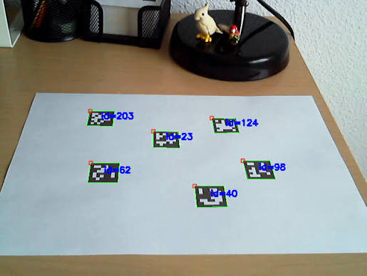

hoe kan ik een robot tracken via een camera?

er zijn een paar opties: "You could use something like AprilTags or ArUco markers. OpenCV can detect these and give you the robot's position. You can get surprisingly good accuracy without machine learning." dus ik kan apriltags gebruiken dit zijn een soort van QR codes het zelfde voor ArUco markers alleen is april gemaakt voor bewegende dingen maar ArUco is suported door de OpenCV library dit is een groote opensourse library voor object tracking ik zou ook machine learning gebruiken maar dit is waarchijnlijk langzaam moelijk en dat snap ik niet 

aanpak: ik ga ArUco markers gebruiken want dit is makkelijk en suported door OpenCV en dit is waarschijnlijk acuraat genoeg zo niet zou ik nog naar april tags kunnen kijken deze zijn namelijk acurater

de camera werkend krijgen via python gaat ongeveer zo: 
        *import cv2
        camera = cv2.VideoCapture(0)
        while True:
            cv2.imshow("Camera", frame)
            if cv2.waitKey(1) & 0xFF == ord("q"):
                break
        camera.release()
        cv2.destroyAllWindows()*

en dan obect tracking is dit:
        *aruco = cv2.aruco
        dictionary = aruco.getPredefinedDictionary(aruco.DICT_4X4_50)
        parameters = aruco.DetectorParameters()
        detector = aruco.ArucoDetector(dictionary, parameters)

        corners, ids, rejected = detector.detectMarkers(frame)
            if ids is not None:
                aruco.drawDetectedMarkers(frame, corners, ids)*

dan krijg je zoiets: 

inzichten: dit is mischien niet snel genoeg, hoe krijg ik dit op de world map, hoe kopel ik dit met godot