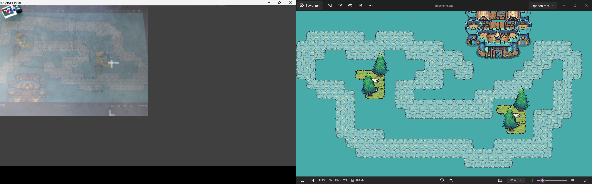
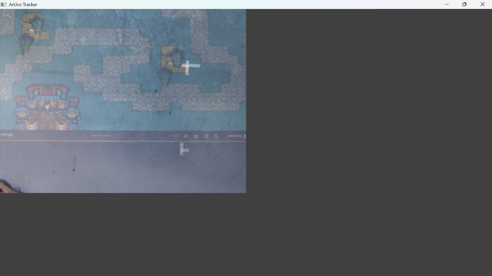

 cam_hight = 146cm

cam dist from center screen = 8,5cm 20cm

cam tilt +- 10

dus de camera moet hoger verder naar het midden ook is het waarschijnlijk te langzaam en de beamer moet beter afgesteld worden

**let op!! steets klijnste afstand gemeeten**

nog perspectief testen: is tien cm ook zoiets op de map, contact met Thijs over afspraken

x=84,5cm y=-2cm : ID: 0 X: 607 Y: 47

x=131.5cm y=83cm : ID: 0 X: 46 Y: 34

x=136cm y=5cm : ID: 0 X: 29 Y: 378

x=11cm y=-1cm : ID: 0 X: 589 Y: 406

cam compleet recht:

