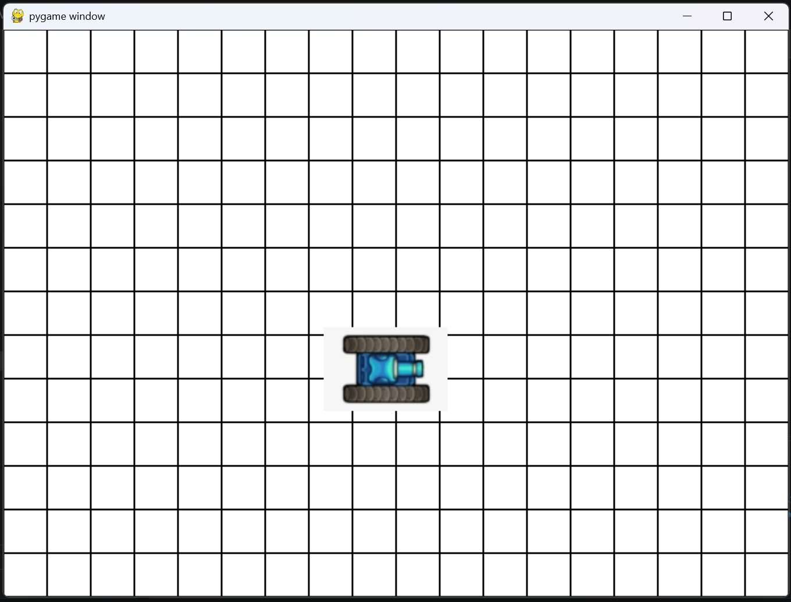

hoe kan ik de fysieke world(x,y) mappen op een virtuele world 

aanpak: ik kan linear mapping gebruiken: dx = cx * (cResolutie / dResolutie) als onze camera recht boven onze map hangt, zoniet kan ik een perspectieftransformatie uitvoeren via numpy.

proof of concept:
dit werk voor nu gewoon linear 

inzichten: werkt dit ook met markers op de hoekken, koppelen met godot op een manier dat we een constante data stream hebben, perspectief probleemen? 