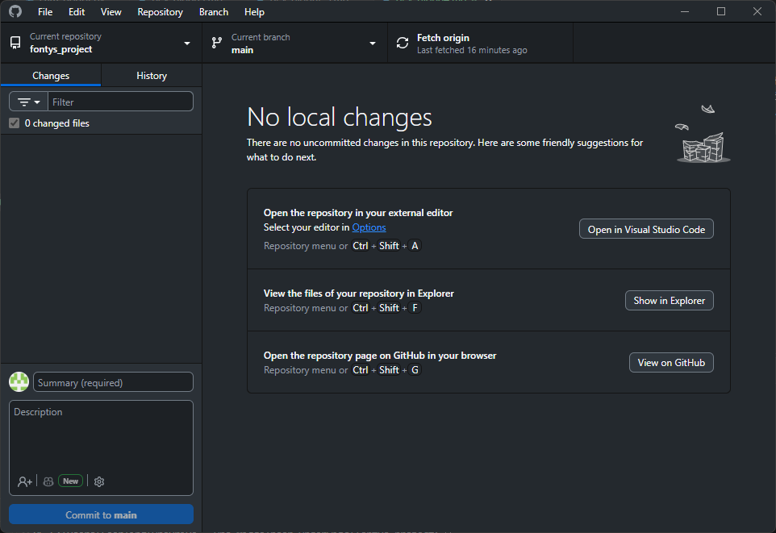

hoe kunnen we samen werken in godot?

aanpak: we gaan waarschijnlijk git(hub) gebruiken want dit werkt goed samen met godot en er is niet echt een betere manier zoals bij word dat je allemaal tegelijk kunnen werken. we hebben dit besproken met lennard en hij was het er mee eens.

hoe gaat dit?
tot nu toe goed we hebben al de godot bestanden die we tot nu toe hadden op github staan in een godot project nu hoopen op niet te veel merge conflicts. ik heb besloten om de github desctop app te gebruiken omdat ik geen zin had om dit elkekeer via een cli te doen. aangezien de anderen nog nooit met git hebben gewerkt leek me dit ook een goed idee.

git 